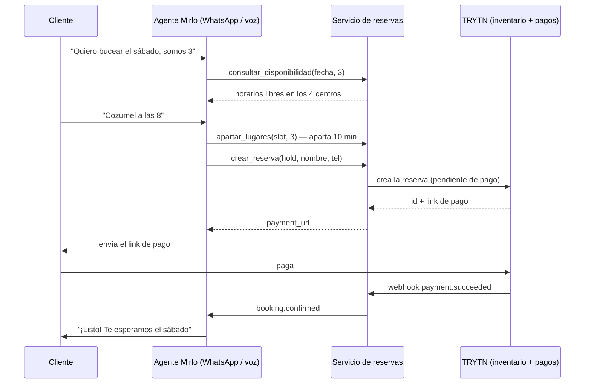

# Sistema de reservas de buceo: Mirlo ↔ TRYTN

Servicio intermedio que permite a los agentes de IA de **Mirlo** (WhatsApp y llamadas)
**cerrar ventas** sobre el inventario de **TRYTN**, manteniendo una sola disponibilidad
compartida para los **4 centros de buceo**.

## Cómo funciona



**Puntos clave**

| Problema | Solución |
|---|---|
| WhatsApp y voz venden el mismo último lugar | Toda venta pasa por un apartado atómico (transacción `BEGIN IMMEDIATE`); el segundo agente recibe "solo quedan N lugares". |
| Clientes que no terminan | El apartado vence a los 10 min y la reserva sin pagar a los 30 min; el lugar se libera y la reserva se cancela en TRYTN. |
| Ventas por la web o en mostrador | TRYTN avisa por webhook (`availability.updated`) y existe `POST /admin/sync` como respaldo; esas ventas se descuentan del cupo. |
| El agente reintenta y duplica la venta | Header `Idempotency-Key` en `crear_reserva`. |
| Webhooks falsos o repetidos | Firma HMAC-SHA256 y deduplicación por id de evento. |
| 4 centros | Una sola búsqueda devuelve todos; si un centro está lleno, el agente ofrece otro. |

## Estructura

```
app/service.py   lógica de disponibilidad, apartados, ventas y pagos
app/trytn.py     adaptador TRYTN (mock para pruebas + cliente HTTP)
app/main.py      API: /tools/* para Mirlo, /webhooks/trytn para TRYTN
app/notifier.py  avisos a Mirlo (pago confirmado, cancelado, fallido)
app/seed.py      datos de ejemplo (4 centros, tours y horarios)
mirlo/tools.json              definición de herramientas para los agentes
mirlo/instrucciones-agente.md instrucciones para el prompt de los agentes
tests/                        pruebas del flujo completo
```

## Probar localmente

```bash
cd reservas-buceo
pip install -r requirements.txt
cp .env.example .env && export $(grep -v '^#' .env | xargs)
python -m app.seed                         # carga datos de ejemplo
uvicorn app.main:create_app --factory --reload
# Documentación interactiva: http://localhost:8000/docs
python -m pytest                           # pruebas
```

## Pasos para ponerlo en producción

1. **TRYTN**: pide a soporte de TRYTN acceso a la API y a webhooks. Necesitas:
   - crear una reserva en estado "pendiente de pago" y obtener su link de pago;
   - cancelar una reserva;
   - consultar disponibilidad por producto/horario;
   - webhooks de pago confirmado/fallido, reserva cancelada y cambio de cupo.
   Con esa documentación, ajusta las rutas marcadas `TODO(TRYTN)` en `app/trytn.py`
   y pon `TRYTN_MODE=http`.
   *Si TRYTN no ofrece API*, el adaptador puede usar su link de reserva/pago por
   producto y su exportación o integración (Zapier, etc.) como fuente del webhook;
   el resto del sistema no cambia.
2. **Catálogo**: reemplaza `app/seed.py` por tus centros y tours reales, con el
   `trytn_product_id` y `trytn_slot_id` de cada uno (o cárgalos con `/admin/sync`).
3. **Despliegue**: cualquier servidor con HTTPS (Render, Railway, Fly.io, un VPS).
   Guarda la base de datos en un volumen persistente. Configura las variables de
   `.env.example`.
4. **Mirlo**: en cada agente (WhatsApp y voz) da de alta las herramientas de
   `mirlo/tools.json` con la URL del servicio y el header `X-API-Key`, pega
   `mirlo/instrucciones-agente.md` en su prompt y configura `MIRLO_NOTIFY_URL`
   con el webhook de Mirlo que dispara el mensaje de confirmación.
5. **TRYTN → servicio**: registra `https://TU-DOMINIO/webhooks/trytn` como webhook
   con el secreto `TRYTN_WEBHOOK_SECRET`.

## Decisiones pendientes del negocio

- Minutos de apartado (10) y de plazo de pago (30): `HOLD_MINUTES`, `PAYMENT_MINUTES`.
- Política de cambios y reembolsos: hoy una reserva pagada se pasa a un asesor.
- Si se cobra el total o un anticipo (hoy se cobra el total: precio × personas).
